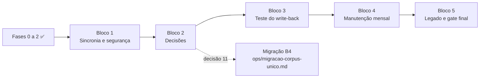

# Plano de organização do projeto (playbook "folders as architecture")

> last-reviewed: 2026-11-15 · quem atualiza: o PR que conclui um passo. O estado de cada passo mora **só aqui**.

Este arquivo é o passo a passo para terminar a organização do projeto e manter Mac, GitHub e Projeto claude.ai
alinhados. O que fazer no conteúdo (fontes, fotos, indexação) está em `data/roadmap.md`, não aqui.

**Legenda:** ✅ feito · ⬜ a fazer · 🔸 espera uma decisão ou ação da dona · quem: **Isis** ou **Claude**.

## Regras para não perder histórico
1. Passo concluído **não é apagado**: ganha ✅, a data e o PR. Passo trocado ganha "substituído por X".
2. Decisão com alternativas vira arquivo em `context/decisoes/` **antes** de mexer no que ela muda.
3. **Nada é apagado antes de existir cópia**: branch vira tag, doc do Projeto vira arquivo no vault.
4. Um passo = um PR (quando mexe no repo) = um review. O PR cita o ID do passo (ex.: "Passo 2.1").
5. O fim do arquivo é um **log** só de acréscimo: o que aconteceu e quando.

## Mapa do plano

## Bloco 1: Sincronia e segurança (resolve "versões diferentes")

| ID | Quem | Passo | Pronto quando | Estado |
|---|---|---|---|---|
| 1.1 | Claude | Clone do Mac em dia; `pull` só avança em linha reta (`pull.ff only`) e limpa branches apagadas | `git status -sb` sem `behind` | ✅ 15/11 |
| 1.2 | Isis | Apagar as 4 branches antigas já contidas na `main` | `git ls-remote --heads` lista só `main` e `redesign-visual` | ✅ 15/11 |
| 1.3 | Isis | **Backup das notas privadas.** Elas existem só na pasta do Mac (o `.gitignore` as mantém fora do GitHub). Escolha um: Time Machine, iCloud ou sync do Obsidian | A pasta do projeto está incluída **e** você restaurou 1 arquivo de teste. Conferir também que `.env.local` (token da Vercel) não sobe para o serviço de backup | 🔸 **Adiado em 16/11 por decisão da dona.** Obsidian (`isis-brain`) informado, sem teste de restauração; o mínimo recomendado é o Time Machine. Volta na revisão mensal (4.3) |
| 1.4 | Isis | **Proteger a `main` no GitHub:** *Settings → Branches → Add rule* em `main`: exigir pull request, exigir o check `validar` verde, incluir administradores. Se travar numa emergência, desligue, resolva e registre no `ops/runbook.md` | Um `git push` direto na `main` é recusado | ✅ 15/11. Conferido pela API: `main` protegida, check `validar` exigido para todos (inclui administradores). Rodou com a conta da dona, porque o GitHub nega esta permissão à sessão na nuvem |
| 1.5 | Isis | Decisão 6: destino da `redesign-visual` (4 commits únicos, sobre a planilha antiga). *Recomendação:* criar a tag `arquivo/redesign-visual` no último commit e só depois apagar a branch | A tag existe e a decisão está em `context/decisoes/` | 🔸 |
| 1.6 | Claude | Regra datada no router: `data/mapa.xlsx` e `index.html` só mudam por branch e PR, nunca direto na `main` do Mac | PR mergeado | ⬜ |

**Por que o 1.4 é a peça central:** o `mapa.xlsx` é binário e não se mescla. Enquanto a migração B4 não vem, a
única defesa é nunca haver duas versões dele andando juntas: um lote por PR, o próximo só abre depois do merge do
anterior. A proteção da `main` transforma essa regra de hábito em trava.

## Bloco 2: Decisões que destravam o trabalho

Ela decide; o Claude escreve o arquivo em `context/decisoes/` e atualiza a linha no `data/roadmap.md`.

| ID | Quem | Decisão | Recomendação | Estado |
|---|---|---|---|---|
| 2.1 | Isis | Decisões 2, 3 e 4 do roadmap, que valem para a fila inteira do A2 (rebaixar, reescrever ou cortar; fonte de paywall; ritmo de um lote por PR) | Aprovar como estão escritas no roadmap | ✅ 15/11, [protocolo do A2](../context/decisoes/2026-11-15-protocolo-a2-rebaixar-reescrever-cortar.md) |
| 2.2 | Isis | Decisão 11: quando migrar a B4 | Só entre dois lotes de A2, sem PR editorial aberto, JSON idêntico como critério de aceite. **Faz-se na sessão 2 do Bloco 3** | 🔸 |
| 2.3 | Isis | `CODEOWNERS` (o plano original previa; nunca foi criado) | Não criar: com uma dona só e o passo 1.4, não acrescenta controle. Registrar a decisão | ✅ 15/11, [sem CODEOWNERS](../context/decisoes/2026-11-15-sem-codeowners.md) |

As decisões 1, 5, 7, 8, 9 e 10 seguem no roadmap, cada uma no momento em que trava um item.

## Bloco 3: Teste do write-back (Fase 3 do playbook)

Prova que uma sessão nova, só com o `CLAUDE.md`, grava o que mudou no arquivo certo. Sem avisar sobre write-back.

| ID | Quem | Passo | Estado |
|---|---|---|---|
| 3.1 | Isis | **Sessão 1:** abrir uma sessão **nova** do Claude Code na pasta do Mac e dizer só "Vamos começar o lote 1 do A2". Trazer o diff ou o PR | ✅ 16/11, lote 1 do A2 (PRs #21 e #22) |
| 3.2 | Isis | **Sessão 2:** sessão nova para decidir a 11 (passo 2.2) | ⬜ |
| 3.3 | Claude | Conferir cada sessão: leu o router antes; gravou no arquivo certo; "Estado em 1 minuto" mudou quando devia e sem hash; nada sensível no repo; resumiu em 1 linha | 🔸 Sessão 1 conferida em 19/11: passou, com 1 ajuste (veja o log). Falta a sessão 2 |
| 3.4 | Claude | Se algo falhou: PR que ajusta a redação do router; repetir só a sessão que falhou | ✅ 19/11 para a sessão 1: regra datada no router. Se a sessão 2 falhar em outro ponto, repete |

**Passou** quando as duas sessões cumprem os 5 critérios. O resultado entra no log.

## Bloco 4: Manutenção (Fase 4)

| ID | Quem | Passo | Estado |
|---|---|---|---|
| 4.1 | Claude | `ops/manutencao.md`: checklist mensal (estado do router contra `validate.py` e a `main`; instruções do Projeto contra o router; memória contra o router; números de linha da fila do F7; backup do passo 1.3) | ⬜ |
| 4.2 | Claude | Tarefa mensal agendada que roda o checklist e avisa o que divergiu. Você aprova ao criar | ⬜ |
| 4.3 | Isis | Primeira revisão mensal, até 15/12 (30 dias do `last-reviewed` do router) | ⬜ |

## Bloco 5: Legado e gate final (Fase 5)

| ID | Quem | Passo | Estado |
|---|---|---|---|
| 5.1 | Claude | PR pequeno: "Documentado" → "Reportado" no `README.md` e no texto da aba `Notes` (A12) | ⬜ |
| 5.2 | Claude | PR que **propõe** (não impõe) levar ao `EDITORIAL.md` as regras editoriais que só existem na nota privada de hub. O cabeçalho do `EDITORIAL.md` diz "nada aqui é regra nova", então você aprova regra por regra | ⬜ |
| 5.3 | Claude | **Exportar** os 11 docs do Projeto claude.ai para `docs/historico/projeto-claude-ai/` no vault (cópia local, fora do GitHub) | ⬜ |
| 5.4 | Isis | Só depois de conferir as cópias do 5.3: remover os 11 docs do Projeto, para o chat não consultar plano velho | ⬜ |
| 5.5 | Claude | Reduzir o hub `Mapa de Envolvidos.md` a ponteiros para `CLAUDE.md`, roadmap e decisões, mantendo só o que é privado | ⬜ |
| 5.6 | Claude | Conferir a memória do claude.ai sobre o projeto contra o router e corrigir o que divergir | ⬜ |
| 5.7 | Isis | **Gate final:** conversa nova nas 3 portas perguntando "qual o estado do projeto?"; as 3 respostas batem com o router | ⬜ |

## Ordem sugerida

1. Hoje: 1.3 e 1.4 (são suas e rápidos). 2.1 e 2.3 já estão feitos.
2. Em seguida: 3.1 (sessão 1 com o A2 lote 1) e 1.5.
3. Quando quiser: 3.2 (decisão 11), e então 3.3 e 3.4.
4. Depois: Bloco 4, e a primeira revisão do 4.3 até 15/12.
5. Por fim: Bloco 5, com 5.7 fechando o plano.

A migração B4 não está aqui: tem prompt próprio em `ops/migracao-corpus-unico.md` e só começa depois do passo 2.2.

## Log (só acréscimo)

| Data | O que aconteceu |
|---|---|
| 2026-11-15 | Fase 0: inventário do repo, da pasta do Mac e do Projeto claude.ai |
| 2026-11-15 | Fase 1: router `CLAUDE.md` (PRs #10 e #11) e gate de leitura nas 3 portas |
| 2026-11-15 | Fase 2: roadmap (#12), fila do F7 (#13), decisões (#14), `ops/` (#15), whitelist ancorada e runbook (#16); planos executados movidos para o vault |
| 2026-11-15 | Passos 1.1 e 1.2 feitos; instruções do Projeto atualizadas pela dona |
| 2026-11-15 | Plano publicado (#17). Passos 2.1 e 2.3 aprovados e registrados em `context/decisoes/`. Passo 1.3: Obsidian informado, teste de restauração pendente. Passo 1.4: prompt entregue |
| 2026-11-15 | Passo 1.4 feito: `main` protegida (check `validar` para todos). #18 mergeado |
| 2026-11-16 | #19 mergeado. Passo 1.3 (backup) adiado pela dona; as notas privadas seguem só no Mac. Reavaliar na primeira revisão mensal |
| 2026-11-19 | Fase 3, sessão 1 (lote 1 do A2, #21 e #22), conferida contra o repo. Passou: arquivo certo (estado e fila, sem `.md` solto), sem hash, contagens corretas (F7 8 de 72; 141 e 72 intactos), nada sensível, `validate.py` 0 erros e os mesmos 3 avisos. Ajuste: o #21 escreveu "PR aberto, aguardando aprovação" no estado e na fila, fato que morre no merge, e precisou do #22 para corrigir. Corrigido com regra datada no router. Pontos de conteúdo para a dona na linha 124 (fonte registrada por republicação) e na linha 122 (data "2026" sem dia) |
